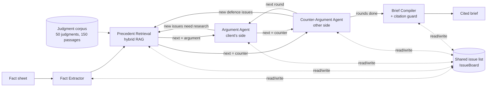

# Legal Case Precedent Briefing Assistant

A multi-agent system that turns a case fact sheet into a short brief citing relevant precedents.
Five specialised agents, built on **Microsoft Agent Framework** (Python, `agent-framework-core` 1.24), run a
**debate architecture with a compiler**: an Argument Agent and a Counter-Argument Agent argue each issue from
precedents retrieved by **RAG over a judgment corpus**, every agent reads and writes a **shared issue list**, and
a Brief Compiler merges both sides into a brief in which **every claim carries a citation** that is checked
against the corpus.

> **Academic demonstration only. Nothing this system produces is legal advice.** The fact sheets are synthetic
> (fictional people and companies). The corpus holds short paraphrased teaching summaries of 50 leading, publicly
> reported English tort and contract judgments, not official law reports.

**Project documents:** [report (PDF)](docs/Legal_Case_Precedent_Briefing_Assistant_Report.pdf) ·
[presentation (PPTX)](docs/Legal_Case_Precedent_Briefing_Assistant.pptx) ·
[presentation (Google Slides)](https://docs.google.com/presentation/d/1ZYiLd4nWZ3Nj-b2I5RU336dvT1MRqbHR/edit?usp=sharing&ouid=109391127952070662017&rtpof=true&sd=true)

---

## Contents

0. [Compliance with the general instructions](#compliance-with-the-general-instructions)
1. [What it produces](#what-it-produces)
2. [Architecture](#architecture)
3. [The five agents](#the-five-agents)
4. [Retrieval and shared memory](#retrieval-and-shared-memory)
5. [Citations and the citation guard](#citations-and-the-citation-guard)
6. [Setup](#setup)
7. [Running it](#running-it)
8. [Using an LLM](#using-an-llm)
9. [Evaluation](#evaluation)
10. [Project layout](#project-layout)
11. [Tests](#tests)
12. [Limitations and next steps](#limitations-and-next-steps)

---

## Compliance with the general instructions

| Instruction | How this project meets it |
|---|---|
| Build only the listed agents, outputs and evaluation | Exactly five agents (Fact Extractor, Precedent Retrieval, Argument, Counter-Argument, Brief Compiler); outputs are the issues, supporting and opposing precedents, and a brief with a citation for every claim; evaluation reports precedent recall and the share of citations that exist in the corpus |
| No polished UI required | Command-line demonstration (`python -m legal_brief ...`) |
| Tools may be mock tools over local files; no paid or external service required | All agent tools (`search_judgments`, `read_passage`, `list_issues`, `add_issue`, `record_precedent`) read and write local data only. The whole pipeline and evaluation run offline with no API key; an LLM provider is optional |
| Own small retrieval corpus (10–20 short documents sufficient) | 50 short judgment summaries in `data/corpus/judgments.json`, written for this project |
| Own synthetic test cases with known answers | 8 synthetic fact sheets in `data/fact_sheets/` with known relevant precedents in `data/eval/gold.json` |
| Group-of-3 add-on | None is listed for this project |
| Only synthetic or publicly available data; no real personal data | Fact-sheet parties are fictional; the corpus summarises publicly reported judgments |
| Legal projects are academic demonstrations, not professional advice | Stated here and at the top of every generated brief |

---

## What it produces

For each fact sheet the system writes to `outputs/<case id>/`:

| File | Contents |
|---|---|
| `brief.md` | The brief: summary, issues, key facts, for each issue the **supporting and opposing precedents** with the proposition each stands for, both sides' arguments, an assessment, a conclusion, the authorities cited and a citation check. Every statement ends with its citations. |
| `brief.json` | The same brief as structured data (`legal_brief.models.Brief`). |
| `raw_brief.json` | The compiler's output **before** the citation guard (used to measure citation existence). |
| `issue_board.json` | The shared issue list: issues, candidate precedents, stances, notes and the full event log of which agent wrote what. |
| `debate.md` | The debate transcript, round by round, plus the issue-list event log. |
| `trace.json` | Structured facts (parties, chronology, claims), citation reports, timings, warnings and every agent step. |

Example (from `outputs/eval/FS04/brief.md`):

```text
## I1. Was the contract frustrated by a supervening event that destroyed its common foundation?
Supporting precedents
| Krell v Henry [1903] 2 KB 740 | A contract may be frustrated ... where a supervening event destroys a state
  of affairs which both parties regarded as the basis of the contract ... | Krell v Henry [1903] 2 KB 740, ¶3 |
Opposing precedents
| Herne Bay Steam Boat Co v Hutton [1903] 2 KB 683 | Frustration does not apply where the event defeats only one
  party's purpose ... | Herne Bay Steam Boat Co v Hutton [1903] 2 KB 683, ¶3 |
Argument for the other side
- Herne Bay Steam Boat Co v Hutton ... supports Skyline Terraces Ltd on this issue: ... That reasoning applies
  here: The terrace, bar and staff remained available on 5 July 2025 ... — Herne Bay ... ¶3; Fact sheet ¶5
```

---

## Architecture

The coordination pattern is a **debate with a compiler**, implemented as an Agent Framework `Workflow`
(`WorkflowBuilder` with one `Executor` per agent and conditional edges):



A run on FS01 follows this path (from `trace.json`):

```text
fact_extractor -> precedent_retrieval -> argument:round1 -> counter:round1
               -> argument:round2 -> counter:round2 -> brief_compiler
```

When a debater adds an issue (for example the Counter-Argument Agent raising a causation or exclusion-clause
defence), the workflow routes back to Precedent Retrieval before that debater speaks, so every issue is
researched before it is argued. The number of rounds is configurable (`--rounds`, default 2): round 1 opens each
side's case, later rounds answer the other side's points (`responds_to`) by distinguishing its authorities.

Code: [`src/legal_brief/orchestration/debate_workflow.py`](src/legal_brief/orchestration/debate_workflow.py).

---

## The five agents

Each agent is its own module under [`src/legal_brief/agents/`](src/legal_brief/agents/). With an LLM configured,
each wraps an Agent Framework `Agent` with its own instructions, its own tools and a pydantic structured-output
schema. Without one, each runs a deterministic baseline so the whole system works offline and reproducibly.

| Agent | Module | Reads | Writes to the shared issue list | Output |
|---|---|---|---|---|
| **Fact Extractor** | `fact_extractor.py` | fact sheet | candidate issues | `StructuredFacts`: parties, dated chronology (ISO dates), claims, key facts with `F#` refs |
| **Precedent Retrieval** | `precedent_retrieval.py` | open issues | candidate precedents per issue | ranked judgments and passage refs; LLM mode lets the agent reformulate queries through the `search_judgments` tool and rerank, while always keeping the hybrid shortlist |
| **Argument** | `argument.py` | issues, candidates, opponent's points | framed issue questions, the answer the client needs, supporting stances, notes | `DebateTurn` of cited points for the client |
| **Counter-Argument** | `counter_argument.py` | issues, candidates, opponent's points | defence issues, opposing stances, notes | `DebateTurn` of cited points for the other side |
| **Brief Compiler** | `brief_compiler.py` | everything | final assessment per issue | `Brief`, then the citation guard and citation reports |

Shared debate behaviour (perspective, stance, distinguishing an opponent's authority) lives in
[`debate_base.py`](src/legal_brief/agents/debate_base.py). Agent tools (Agent Framework `FunctionTool`s) are in
[`tools.py`](src/legal_brief/tools.py): `search_judgments`, `read_passage`, `list_issues`, `add_issue`,
`record_precedent`; writes are attributed to the calling agent.

---

## Retrieval and shared memory

**RAG over the judgment corpus** ([`retrieval/index.py`](src/legal_brief/retrieval/index.py)) indexes every passage
(facts, holding, principle) of the 50 judgments in [`data/corpus/judgments.json`](data/corpus/judgments.json):

- **BM25** for exact legal vocabulary ("invitation to treat", "frustrated").
- **LSA dense vectors** (truncated SVD of a TF-IDF matrix) for paraphrase matching, with no model download.
- The two scores are normalised and fused (0.6 / 0.4), then aggregated to judgment level.
- An optional **doctrine metadata boost** (`DOCTRINE_BOOST`, default 0.35) favours judgments tagged with the issue's
  doctrine. The evaluation reports recall with and without it.

**Shared issue list** ([`memory/issue_board.py`](src/legal_brief/memory/issue_board.py)) is a blackboard every agent
reads and writes. Each issue holds its question, doctrine, the answer the client needs, candidate precedents,
supporting and opposing stances, notes per round and the final assessment. Every write is logged with its author,
so `issue_board.json` shows exactly how the issue list evolved. A snapshot is also stored in the workflow's state
after each step.

The [doctrine taxonomy](src/legal_brief/doctrines.py) (22 doctrines such as `duty_of_care`, `informed_consent`,
`frustration`, `exclusion_clause`) gives issues a common vocabulary and lets the debaters tell supporting from
opposing authority: each judgment is tagged `pro`, `contra` or `mixed` for the doctrines it decides.

---

## Citations and the citation guard

Citation ids: `J06:p3` (passage 3 of judgment J06), `J06` (whole judgment), `F2` (fact-sheet paragraph 2).
[`citations.py`](src/legal_brief/citations.py) validates every structured citation, every inline `[J06:p3]`, and
every free-text case name (`X v Y`) in a statement against the corpus.

The Brief Compiler then runs a **citation guard**: citations that do not exist are removed, a claim that names a
case not in the corpus is dropped, and a claim left with no valid citation is dropped; each repair becomes a
warning in the brief. Citation existence is measured on the raw compiler output (before the guard) and on the
final brief.

---

## Setup

Requires Python 3.10+.

```bash
python -m venv .venv
```

```bash
.venv\Scripts\activate
```

(macOS / Linux: `source .venv/bin/activate`)

```bash
pip install -r requirements.txt
```

```bash
pip install -e .
```

For Claude, also install the preview Anthropic connector:

```bash
pip install --pre agent-framework-anthropic==1.0.0b261030
```

---

## Running it

Generate a brief (offline mode needs no API key):

```bash
python -m legal_brief brief data/fact_sheets/FS01_nair_v_brightwater.md --show
```

Run the evaluation on the 8 fact sheets:

```bash
python -m legal_brief eval
```

Query the corpus directly, or list it:

```bash
python -m legal_brief search "advertisement reward money deposited to show sincerity" --doctrine offer_acceptance
```

```bash
python -m legal_brief corpus
```

Useful options: `--rounds 3`, `--top-k 7`, `--boost 0` (text-only retrieval), `--out <dir>`, `-v` (log every agent
step). You can write your own fact sheet in the same Markdown shape as the files in `data/fact_sheets/`
(`# Fact Sheet FSxx: Title`, `Acting for:`, `## Parties`, numbered `## Facts`, `## Client's objective`).

---

## Using an LLM

Copy `.env.example` to `.env` and set a provider, or pass `--provider` and `--model`:

| Provider | `LLM_PROVIDER` | Needs |
|---|---|---|
| Microsoft Foundry | `foundry` | `FOUNDRY_ENDPOINT`, `FOUNDRY_API_KEY`, `LLM_MODEL` = deployment name. A deployment name starting with `claude` uses Agent Framework's `AnthropicFoundryClient`; any other (GPT etc.) uses the Azure OpenAI chat-completions client |
| OpenAI | `openai` | `OPENAI_API_KEY`, `LLM_MODEL` |
| Azure OpenAI | `azure_openai` | `AZURE_OPENAI_ENDPOINT`, `AZURE_OPENAI_API_KEY`, `LLM_MODEL` (deployment name) |
| Anthropic Claude | `anthropic` | `ANTHROPIC_API_KEY`; `LLM_MODEL` defaults to `claude-opus-5-5` |
| Ollama / any OpenAI-compatible server | `ollama` | `OLLAMA_BASE_URL`, `LLM_MODEL` |

Confirm the key and deployment with one small request before a full run:

```bash
python -m legal_brief check
```

```bash
python -m legal_brief eval
```

In LLM mode each agent uses provider-native structured output (pydantic `response_format`), falling back to JSON
parsing for models without it. If a call fails or returns unparseable output, that agent step falls back to the
offline baseline and the brief records a warning; set `STRICT_LLM=true` to fail instead. Retrieval in LLM mode can
only add real judgments to the hybrid shortlist (unknown ids are discarded), so a model cannot lower recall below
the baseline.

---

## Evaluation

Eight fact sheets ([`data/fact_sheets/`](data/fact_sheets/)) cover negligence, informed consent, unilateral offers,
frustration, remoteness and exclusion clauses, consideration, and psychiatric harm. Each has 3–4 known relevant
precedents in [`data/eval/gold.json`](data/eval/gold.json), on both sides of the argument.

Metrics ([`evaluation/metrics.py`](src/legal_brief/evaluation/metrics.py)):

- **Precedent recall** = gold precedents found ÷ gold precedents, at retrieval (shared issue list) and in the final
  brief, plus a text-only retrieval ablation (doctrine boost off).
- **Citation existence** = citations that resolve to a real corpus passage or fact paragraph ÷ all citations
  (free-text case names included), on the raw compiler output and on the final brief.
- **Claim coverage** = statements with at least one verified citation ÷ statements.

Results, offline mode (`python -m legal_brief eval`, full report in
[`outputs/eval/report.md`](outputs/eval/report.md)):

| Metric (macro average, 8 fact sheets) | Offline |
|---|---|
| Precedent recall: retrieval | 100% |
| Precedent recall: retrieval, text only | 100% |
| Precedent recall: final brief | 100% |
| Citations that exist in the corpus: raw | 100% (413 of 413) |
| Citations that exist in the corpus: final brief | 100% |
| Claims carrying a verified citation | 100% |
| Cited judgments on the gold list | 69% |

How to read these numbers:

- Recall is high because the corpus is small (50 judgments) and the fact sheets were written against it; treat it
  as a check that the pipeline works, not as a benchmark of legal research quality.
- Offline, the agents can only cite passages they retrieved, so citation existence is 100% by construction. With an
  LLM provider the same metric measures hallucinated citations: the test suite feeds the pipeline a model reply that
  cites a non-existent `J88:p1` and an invented case, and checks that raw existence drops below 100% and that the
  guard removes both.
- "Cited judgments on the gold list" below 100% is expected: briefs also cite related authorities (for example
  *Robinson* and *Caparo* on duty of care) that are relevant but not in the minimal gold list.

### LLM mode: Microsoft Foundry, `gpt-4.1-mini`

Three runs on 15 November 2026, about 9 model calls per fact sheet. Full reports:
[run 1](outputs/llm_gpt-4.1-mini/eval/report.md), [run 2](outputs/llm_gpt-4.1-mini_run2/eval/report.md),
[run 3](outputs/llm_gpt-4.1-mini_run3/eval/report.md).

- Before run 2: prompts tell the agents that issue labels are not citations and that the brief must list every
  authority either side used; the JSON parser recovers malformed replies.
- Before run 3: the retrieval merge keeps the full hybrid shortlist (see below), and the citation checker accepts
  short case names such as *Robinson v Chief Constable*.

FS08 is excluded from the averages: Azure's content filter on the deployment blocked every request for that case
(it describes a road accident and injuries) in all three runs, so its brief came entirely from the offline baseline.

| Metric (FS01-FS07) | Offline | Run 1 | Run 2 | Run 3 | LLM mean |
|---|---|---|---|---|---|
| Precedent recall: retrieval | 100% | 100% | 95% | 100% | 98% |
| Precedent recall: final brief | 100% | 80% | 88% | 79% | 82% |
| Citations that exist in the corpus: raw | 100% | 98.6% (580 / 588) | 97.3% (586 / 602) | 99.4% (623 / 627) | 98.4% |
| Citations that exist in the corpus: final brief | 100% | 100% | 100% | 100% | 100% |
| Claims carrying a verified citation | 100% | 100% | 100% | 100% | 100% |
| Cited judgments on the gold list | 69% | 51% | 62% | 51% | 55% |
| Agent steps that fell back to the baseline | 0 | 1 | 0 | 0 | |

What the LLM runs show:

- **The model never invented an authority.** Every non-existent citation (8, 16 and 4 in the three runs) was an
  issue label (`I1`, `I2`, ...) placed in a citations list. The citation guard removed all of them, so every final
  brief is 100% verified.
- **Compiling the brief is the weak step, not retrieval.** With the merge fix, retrieval recall is 100% (run 3), but
  the model consistently leaves some relevant authorities out of the brief: FS06 cites 2 of 4 in all three runs,
  *Boots* (FS03) is missed in all three, and *High Trees* (FS07) in two. Brief recall moves between 79% and 88%
  from run to run with no code change behind the difference, so the prompt change between runs 1 and 2 cannot be
  credited with an improvement.
- **The retrieval merge bug** (run 2 lost *Boots* at retrieval because the merged list was truncated) is fixed: the
  model's own picks are capped and the hybrid shortlist is always kept, so LLM retrieval recall cannot fall below
  the baseline. Run 3 confirms 100%.
- Run 2's raw citation count was re-audited after fixing a checker false positive (a short form of *Robinson v
  Chief Constable of West Yorkshire Police* was flagged as unknown).
- A natural next step is to make the compiler's precedent lists complete by construction: start each issue's
  supporting and opposing lists from the authorities the debaters relied on or attacked, and let the model write
  the propositions.

---

## Project layout

```text
data/
  corpus/judgments.json        50 judgments x 3 passages, doctrine tags
  fact_sheets/FS01..FS08.md     evaluation fact sheets
  eval/gold.json                known relevant precedents per fact sheet
src/legal_brief/
  agents/                       one module per agent + debate_base.py + base.py (CaseSession)
  orchestration/debate_workflow.py   Agent Framework workflow (debate + compiler)
  retrieval/index.py            BM25 + LSA hybrid retriever with doctrine boost
  memory/issue_board.py         shared issue list (blackboard) with event log
  citations.py                  citation ids, validation, guard, rendering
  doctrines.py                  doctrine taxonomy and issue detection
  tools.py                      Agent Framework function tools for LLM agents
  llm.py                        chat-client factory and structured-output helper
  evaluation/                   metrics and evaluation runner
  render.py, cli.py, config.py, models.py, factsheet.py, corpus.py
tests/                          19 tests, including a scripted-LLM end-to-end test
outputs/                        generated briefs and the evaluation report
```

---

## Tests

```bash
python -m pytest -q
```

The suite covers corpus loading and retrieval, fact extraction, the issue list, citation validation and the
guard, the full offline debate on three fact sheets, the evaluation harness, and the LLM path through Agent
Framework with a scripted chat client (structured outputs, a real tool call to `list_issues`, a hallucinated
citation, and fallback when the model returns garbage).

---

## Limitations and next steps

- The offline baseline detects issues and stance from a keyword taxonomy and corpus doctrine tags; it is a
  reproducible floor, not legal reasoning. LLM mode is where issue framing and argument quality come from.
- The corpus is a small set of paraphrased summaries. A real deployment would index full judgments (for example
  from the National Archives' Find Case Law service) with paragraph-level citations.
- Swapping LSA for a sentence-embedding model, adding a reranker, and grading argument quality with an LLM judge
  are natural extensions; the retriever and evaluation runner are written to make that straightforward.
